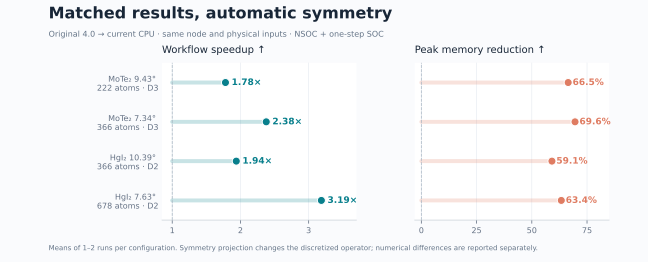
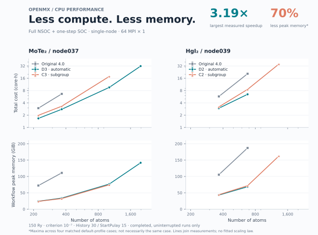
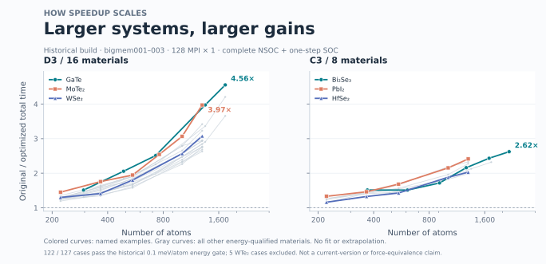

# OpenMX CPU: Symmetry optimization

[简体中文](README.zh-CN.md) · English

This CPU version of [OpenMX](https://www.openmx-square.org/) adds symmetry-based block solvers, density-matrix optimizations and memory improvements. One executable contains both NSOC and SOC paths and uses ordinary OpenMX inputs and MPI launches.

**The CPU source is currently on `develop`. Clone that branch explicitly; the default branch does not contain `cpu/`.**

[Installation](#1-get-and-build) · [NSOC → SOC](#3-nsoc-one-step-soc-and-hs-export) · [Tolerance and errors](cpu/docs/SYMMETRY_TOLERANCE.md)

## Measured speed and memory

**Two materials, four symmetry paths (D3/C3 and D2/C2).** Four completed, same-node comparisons of the automatic D3/D2 profile currently show **1.78–3.19× workflow speedup** and **59–70% lower peak memory** versus original OpenMX 4.0. These are fixed-geometry, nonmagnetic Gamma calculations: converged NSOC followed by **one SOC step from each run's own checkpoint**, not fully self-consistent SOC.



| Material / atoms | Group | Original → current (s) | Speedup | Peak original → current (GiB) | Memory saved |
|---|---|---:|---:|---:|---:|
| MoTe₂ 9.43° / 222 | D3 | 166.8 → 93.7 | **1.78×** | 72.1 → 24.2 | 66.5% |
| MoTe₂ 7.34° / 366 | D3 | 372.4 → 156.6 | **2.38×** | 110.9 → 33.8 | 69.6% |
| HgI₂ 10.39° / 366 | D2 | 321.9 → 166.0 | **1.94×** | 105.3 → 43.0 | 59.1% |
| HgI₂ 7.63° / 678 | D2 | 1160.2 → 364.1 | **3.19×** | 187.2 → 68.6 | 63.4% |

All pairs use **64 MPI × 1, 150 Ry, criterion 10⁻⁷, History30, StartPulay15**, the same physical inputs and the same node for each material (Intel Xeon Gold 6530, about 251 GiB). Current results use `scf.Symmetry on` with the automatic profile and **no optional low-memory overrides**. Total time includes symmetry preparation and native force evaluation; memory includes shared pages once and file cache. Results are means of 1–2 runs, and include SCF iteration-count changes as well as per-step acceleration.

**Numerical scope:** symmetry projection changes the discretized operator. Across these four pairs, the maximum energy difference is 0.0664 meV/atom. MoTe₂ has maximum force differences up to 12.5 meV/Å, while HgI₂ is below 0.24 meV/Å; the MoTe₂ cases therefore do **not** meet a 1 meV/Å force-equivalence target. Timing improvements are not a claim of identical forces or general accuracy convergence.



The upper panels use log–log axes for **atom count versus core-hours**; lower panels show memory on a linear vertical axis. D3/C3 and D2/C2 are labeled separately. Lines join measured cases, without extrapolation; missing original-code points are not zero or successful timings. The larger-case campaign is still in progress. [Measurements, method, per-stage times and numerical differences](cpu/docs/benchmarks/regular256_20261110/README.md) · [CSV](cpu/docs/benchmarks/regular256_20261110/paired.csv) · [PDF](cpu/docs/benchmarks/regular256_20261110/scaling.pdf).

## Historical scaling across 25 materials

The earlier bigmem campaign covered **25 materials / 127 structures**, down to **3.89°**. The figure below shows the 122 structures passing its energy threshold (24 materials); five WTe₂ cases failed and remain in the data. It measures an **earlier specialized build**, with 128 MPI × 1 and an original-code reference on the same node per pair. It is separate from the current-release measurements above.



The larger cases generally show greater acceleration: MoTe₂ goes from **1.45× at 222 atoms to 3.97× at 1,302 atoms**; GaTe reaches **4.56× at 1,736 atoms**. The trend is not strictly monotonic for every material. These are measured historical NSOC + one-step SOC results, not a claim that the latest release has been retested on all 25 materials. Historical memory monitoring is not comparable to the current physical-peak metric. [Data, version boundaries and reproduction](cpu/docs/benchmarks/bigmem_historical_20261022/README.md).

## Current CPU baseline

The current release candidate retains the validated **v6-clean** native SCF baseline. Recent vacuum-height and z-grid experiments did not establish a useful general replacement. They are not enabled by this release, and the code does not silently lower the integration cutoff or relax the SCF criterion. Optional experimental density-startup modes remain disabled.

See [v6 baseline and validation](cpu/docs/V6_BASELINE.md) · [Changes since the previous CPU branch](cpu/docs/CHANGES_V6.md) for the retained memory paths, tested scope and accuracy limits.


## 1. Get and build

The tested build uses Linux, Intel oneAPI 2022.3 classic compilers, Intel MPI 2021.7.1 and MKL 2022.2.1. The supplied Python environment includes NumPy, SciPy, spglib and complex PETSc/SLEPc for targeted bands. The builder expects this oneAPI installation layout; see the [build guide](https://github.com/zhangyan31415/openmx/blob/develop/cpu/docs/BUILD.zh-CN.md) for details.

Enabling `scf.Symmetry on` requires NumPy, SciPy and spglib in the Python environment. The MPI root process uses spglib during initialization to detect geometric symmetry; it is not called at every SCF iteration or linked into the OpenMX executable. Explicit `scf.Symmetry off` does not invoke these Python tools. The source builder itself still requires Python.

```bash
git clone --branch develop --single-branch \
  https://github.com/zhangyan31415/openmx.git openmx-cpu
cd openmx-cpu

conda env create -f cpu/environment.yml
conda activate openmx-cpu

# Set the actual oneAPI installation path; compile on a compute node.
OPENMX_ONEAPI=/path/to/oneapi
source "$OPENMX_ONEAPI/setvars.sh"
python cpu/build.py --profile unified \
  --oneapi-prefix "$OPENMX_ONEAPI" \
  --output "$(pwd)/build/cpu" --jobs 8 --execute
```

The output directory must not already exist. It will contain `openmx-cpu`, its companion `resources/`, logs and a build manifest. OpenMX and bundled ELPA are compiled from repository sources. Supply basis sets and pseudopotentials separately through the input's `DATA.PATH`.

## 2. Enable symmetry and run

Place the symmetry setting beside the other SCF controls, before long coordinate blocks. Start from your working material input and replace the control fields below; retain its complete species, basis, cell and coordinate blocks. For a fresh NSOC calculation:

```text
System.Name                    openmx
System.CurrrentDirectory        ./
DATA.PATH                      /path/to/DFT_DATA19
MD.Type                        Nomd
HS.fileout                     on
level.of.fileout                0
scf.SpinPolarization           off
scf.SpinOrbit.Coupling         off
scf.Symmetry                   on
scf.restart                    off
scf.EigenvalueSolver           Cluster
scf.eigen.lib                  elpa2
scf.Kgrid                      1 1 1
scf.Mixing.Type                rmm-diis
scf.Mixing.History             30
scf.Mixing.StartPulay           15
scf.energycutoff               150
scf.criterion                  1.0e-7
```

The optional `scf.Symmetry.Tolerance 1.0e-3` sets the maximum geometry matching tolerance in **Å**; the default with `on` is `5.0e-5`. The automatic scan includes the requested upper bound. If no usable subgroup is found, preparation stops before SCF and reports whether a larger-tolerance candidate was found, only the identity was validated, or mapping/group validation failed. Extra probes are diagnostic only: they do not silently loosen the solve tolerance or change the geometry. [Tolerance settings and failure handling](cpu/docs/SYMMETRY_TOLERANCE.md).

Symmetry is off by default; `scf.Symmetry off` disables it explicitly. When enabled, the program detects and validates a supported subgroup, prepares its symmetry basis, and automatically enables the verified solver and memory optimizations compatible with the input, thread count and rank binding. No separate preparation command or user-written JSON is needed. At startup, rank zero writes a readable symmetry table to standard output and the front of `System.Name.out`: selected group, operation count, geometry residual and each rotation/translation. Residuals use scientific notation; rounding matrix noise affects display only. Invalid mappings or failed solver checks stop the run; raw spatial covariance defects are diagnostic when the general SOC solver explicitly projects H/S.

With the matching oneAPI runtime and Python environment available on the compute node, launch normally, for example **64 MPI ranks × 1 thread**:

```bash
export OMP_NUM_THREADS=1 MKL_NUM_THREADS=1
export OPENBLAS_NUM_THREADS=1 NUMEXPR_NUM_THREADS=1
mpirun -np 64 ./build/cpu/openmx-cpu input.dat -nt 1
```

Multi-node runs use the same executable with the site's MPI or scheduler settings for hosts, processes and binding. Keep the executable and adjacent `resources/` together when moving an installation, and retain the build-time Python environment.

## 3. NSOC, one-step SOC and H/S export

The tested workflow is **fixed geometry, nonmagnetic, Gamma point: converge NSOC, then run one SOC step from that run's own checkpoint**. Use `Cluster` or Gamma `Band`, with `scf.eigen.lib elpa1` or `elpa2`. Add `scf.Symmetry on` to both inputs. Keep geometry, basis, physical settings and MPI layout consistent, and use native C2N restart for SOC. See the [run guide](https://github.com/zhangyan31415/openmx/blob/develop/cpu/docs/WORKFLOW.zh-CN.md) for input and restart requirements. One SOC step is not a self-consistent SOC calculation.

Request H/S files with the ordinary `HS.fileout on` setting. Supported symmetry paths export H/S consistent with the selected group projection. OpenMX orbitals are nonorthogonal; post-processing requires the matching S.

Use separate stage directories so the SOC output does not overwrite the NSOC result:

```text
case/
  nsoc/input.dat    # fresh NSOC; System.Name openmx
  soc/input.dat     # same material input, with the SOC controls below
```

Keep the same geometry, basis, physical settings and MPI/thread layout. In `case/soc/input.dat`, replace the corresponding NSOC controls with:

```text
System.Name                    openmx
System.CurrrentDirectory        ./
scf.SpinPolarization           NC
scf.SpinOrbit.Coupling         on
scf.Symmetry                   on
scf.restart                    c2n
scf.restart.filename           openmx
scf.maxIter                    1
```

Prepare these inputs first, with a **fresh SOC directory**. Use `System.CurrrentDirectory ./` so each stage writes inside its own directory (the spelling is the original OpenMX keyword). If your build is elsewhere, set `OPENMX_BIN` to its actual absolute path. From the repository root, using allocated compute cores:

```bash
OPENMX_BIN="$(pwd)/build/cpu/openmx-cpu"  # resolve before changing directory
export OMP_NUM_THREADS=1 MKL_NUM_THREADS=1
export OPENBLAS_NUM_THREADS=1 NUMEXPR_NUM_THREADS=1

(cd case/nsoc && mpirun -np 64 "$OPENMX_BIN" input.dat -nt 1 > stdout.log 2>&1)
```

After checking NSOC convergence and normal finish, continue in the same shell:

```bash
cp -a case/nsoc/openmx_rst case/soc/
(cd case/soc && mpirun -np 64 "$OPENMX_BIN" input.dat -nt 1 > stdout.log 2>&1)
```

Check `case/nsoc/stdout.log` for normal finish and actual convergence (`CPU_NSOC_SYM_FINAL ... converged=1`); reaching the iteration limit is not convergence. The SOC log must contain `<Restart> Found restart files`, exactly one SCF step and normal finish. Each directory retains its own `openmx.out`, `openmx.scfout` and `openmx_rst/`. OpenMX H/S use a nonorthogonal basis: keep each H paired with its matching S. One SOC step is not self-consistent SOC.

The front of `.out` now prints **Solver path**, **Path reason**, **Geometry tolerance** and **Detected at**. Standard eligible D3/C3 cases select the specialized SOC path; other groups, orientations or observables may require general spinor blocks. Repeating the default covariance value explicitly no longer changes that selection; advanced non-default covariance contracts remain on their checked general path. See [common problems and stage-by-stage use](cpu/docs/WORKFLOW.zh-CN.md).

<details>
<summary>Common installation and restart problems</summary>

| Symptom | Action |
|---|---|
| A Python package is missing when symmetry is enabled | Make the build-time Python environment with NumPy/SciPy/spglib available on compute nodes. No moirekp installation is needed. |
| The program cannot find its preparation helper after moving an installation | Move the executable together with its adjacent `resources/`; keep the recorded Python environment accessible. |
| SOC cannot find a restart | Match `scf.restart.filename` to the NSOC `System.Name`, copy that run's `*_rst/` directory into the SOC directory, and keep the same MPI/thread layout. |
| The program finished but NSOC did not converge | Check the convergence marker and residuals; do not continue from an unconverged checkpoint. |
| A different solver path is selected | Read Solver path and Path reason at the front of `.out`; group/orientation, observables and advanced contracts affect eligibility. |
| Pulling new source did not change installed behavior | Rebuild into a new output directory: preparation resources are installed with the executable. Keep running installations unchanged. |

</details>

For band dispersion, keep the usual `Band.Nkpath` and `<Band.kpath` definitions and add:

```text
Band.dispersion       on
Band.Solver           Auto
Band.NumBands         20
Band.ReferenceEnergy  Fermi
```

This computes the 20 states nearest the reference at each k point using SLEPc, directly from native sparse H/S. `Fermi` is the default reference; a number specifies an absolute energy in **eV**. The normal `.Band` format and its **Hartree** energy units are retained. Zero or omitted `Band.NumBands` keeps the original full-spectrum path. Launch with the same `mpirun` command; no separate export, converter or moirekp installation is required. See the [band guide](https://github.com/zhangyan31415/openmx/blob/develop/cpu/docs/TARGETED_BANDS.md).

For **all bands**, set `Band.NumBands 0` and choose `Band.Solver EVR` or `Auto`.
`LAPACK`/`GVD`, `SLEPc` and `Legacy` are also selectable. GVD/EVR compute energies
without a full wavefunction matrix. An omitted method retains the earlier
count-dependent behavior; see the band guide for exact selection and limits.

## 4. Implementation and validation scope

- D3/C3 include specialized optimizations; other supported subgroups, including D2/C2, use general representation blocks. Check the log for the actual path.
- Symmetry projection can change the discretized operator and SCF trajectory. Energy, forces and other physical errors need separate validation; detection alone does not establish accuracy or speedup.
- The current default profile passed complete NSOC plus own one-step SOC for MoTe₂ at 9.43° (222 atoms) and 7.34° (366 atoms). Standard oriented C3/D3 slabs select the verified specialized SOC path; other supported cases use the general path and its operator checks.
- Historical timing and memory results apply to their recorded configurations. More nodes do not guarantee lower core-hours or constant total memory.

[Native switch validation](https://github.com/zhangyan31415/openmx/blob/develop/cpu/docs/NATIVE_SYMMETRY_VALIDATION_20261106.md) · [Timing and memory benchmarks](https://github.com/zhangyan31415/openmx/blob/develop/cpu/docs/BENCHMARKS_20261031.md) · [Acceptance criteria](https://github.com/zhangyan31415/openmx/blob/develop/cpu/docs/ACCEPTANCE.zh-CN.md) (detailed reports are currently in Chinese).

## Source layout and credits

| Directory | Contents |
|---|---|
| `cpu/vendor/` | OpenMX and ELPA sources and licenses |
| `cpu/overrides/` | Optimized solvers and memory kernels |
| `cpu/geometry/` | Symmetry detection and representation construction |
| `cpu/tools/` | Workflow, comparison and benchmark tools |
| `cpu/tests/`, `cpu/docs/` | Tests and detailed documentation |

[CPU documentation](https://github.com/zhangyan31415/openmx/blob/develop/cpu/README.md). Original OpenMX and ELPA copyright notices and licenses are retained in the sources and `cpu/vendor/`; provenance is recorded in `cpu/vendor/ORIGINS.json`.

The GPU implementation comes from [dc1394/openmx4.0_gpu](https://github.com/dc1394/openmx4.0_gpu); please refer to that project.
