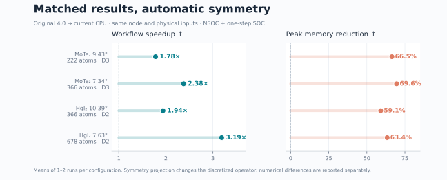
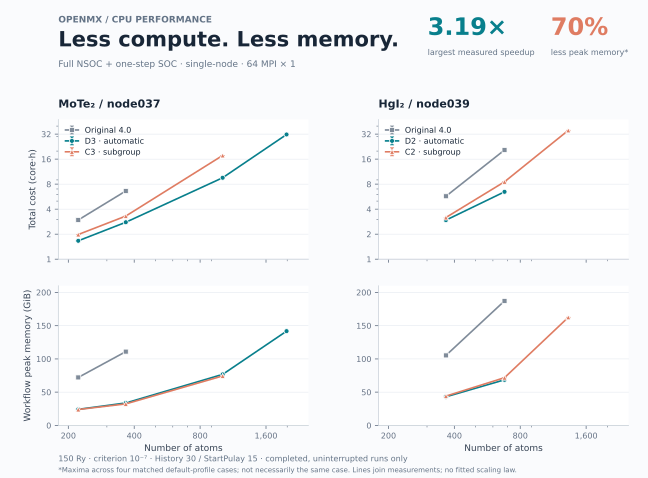
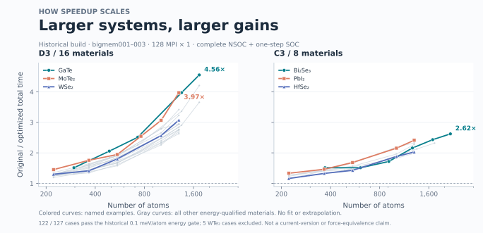

# OpenMX CPU：对称性优化

简体中文 · [English](README.md)

这是基于 [OpenMX](https://www.openmx-square.org/) 的 CPU 优化版本，主要改进对称性分块求解、密度矩阵计算及内存使用。同一个可执行文件包含 NSOC 和 SOC 路径，使用普通 OpenMX 输入文件和 MPI 启动方式。

**CPU 源码目前在 `develop` 分支。请按下面命令克隆；只克隆默认分支不会取得 `cpu/` 目录。**

[安装](cpu/docs/BUILD.zh-CN.md) · [NSOC → SOC](cpu/docs/WORKFLOW.zh-CN.md) · [容差与错误处理](cpu/docs/SYMMETRY_TOLERANCE.md)

## 实测加速与内存

**本轮覆盖2种材料、4条对称性路径：D3/C3和D2/C2。** 目前4组已完成的同节点原版对照中，自动D3/D2配置相对原版OpenMX 4.0，完整流程加速 **1.78–3.19倍**，峰值内存下降 **59%–70%**。测试流程为固定结构、非磁、Γ点的完整收敛NSOC，再从**各自的检查点接一步SOC**，并非全程自洽SOC。



| 材料／角度／原子数 | 群 | 原版→当前耗时（秒） | 加速比 | 原版→当前峰值（GiB） | 内存下降 |
|---|---|---:|---:|---:|---:|
| MoTe₂ 9.43° / 222 | D3 | 166.8 → 93.7 | **1.78×** | 72.1 → 24.2 | 66.5% |
| MoTe₂ 7.34° / 366 | D3 | 372.4 → 156.6 | **2.38×** | 110.9 → 33.8 | 69.6% |
| HgI₂ 10.39° / 366 | D2 | 321.9 → 166.0 | **1.94×** | 105.3 → 43.0 | 59.1% |
| HgI₂ 7.63° / 678 | D2 | 1160.2 → 364.1 | **3.19×** | 187.2 → 68.6 | 63.4% |

各组统一 **64 MPI×1、150 Ry、criterion=10⁻⁷、History30、StartPulay15**，使用相同物理输入；同一材料的前后对照在同一节点完成（Intel Xeon Gold 6530，约251 GiB）。当前版使用 `scf.Symmetry on` 的自动配置，**不叠加额外低内存开关**。图中保留各次实测的配置；下文新增的SOC默认内存策略尚未重测整张图。总耗时包含对称性准备与原生力计算；内存包含共享页一次及文件缓存。数据为每配置1–2次实测均值，总加速同时包含SCF步数变化与单步计算加速。



上排为**原子数—核时双对数折线图**，下排内存纵轴使用线性刻度，D3/C3与D2/C2分别标注。折线只连接实测点，不做外推；缺失的原版结果不代表零耗时或成功完成。小角度对照仍在补测。[原始测量、方法、分阶段耗时及数值差异](cpu/docs/benchmarks/regular256_20261110/README.md) · [CSV](cpu/docs/benchmarks/regular256_20261110/paired.csv) · [矢量PDF](cpu/docs/benchmarks/regular256_20261110/scaling.pdf)。

## 25种材料的历史规模测试

此前bigmem批次覆盖 **25种材料、127组结构，最小到3.89°**。图中展示通过当时能量门限的122组结构（24种材料）；WTe₂的5组未通过，原数据保留。这批使用**早期专用优化版**，统一128 MPI×1，每一对原版／优化版在同一节点完成，与上面的当前版本测试分开呈现。



较大体系总体获得更大的收益：MoTe₂从 **222原子的1.45倍增至1302原子的3.97倍**；GaTe在 **1736原子达到4.56倍**。并非所有材料都严格单调。这是历史版本完整NSOC＋一步SOC的实测，不代表最新版已对全部25种材料复测；历史内存监控也不能与当前物理峰值口径直接混比。[完整数据、版本边界与绘图复现](cpu/docs/benchmarks/bigmem_historical_20261022/README.md)。

## 当前 CPU 基线

当前候选版本保留已验证的 **v6-clean** 原生 SCF 基线。近期缩短真空层、减半 z 网格的实验没有得到值得通用替换的收益，因此不作为本次默认配置；程序不会自动降低积分网格截断或放宽 SCF 收敛阈值。实验性密度初猜保持关闭。

保留的内存路径、验证范围和精度边界见 [v6 基线说明](cpu/docs/V6_BASELINE.md)、[相对已发布 CPU 分支的改动](cpu/docs/CHANGES_V6.md)。


## 1. 获取与安装

已验证的构建环境：Linux、Intel oneAPI 2022.3 classic 编译器、Intel MPI 2021.7.1、MKL 2022.2.1。随包的 Python 依赖环境包含 NumPy、SciPy、spglib，以及用于目标能带的复数 PETSc/SLEPc。构建器要求对应的 oneAPI 目录布局，详见[构建说明](https://github.com/zhangyan31415/openmx/blob/develop/cpu/docs/BUILD.zh-CN.md)。

开启 `scf.Symmetry on` 需要 Python 环境中的 NumPy、SciPy 和 spglib。spglib 由 MPI 主进程在启动阶段调用，用于识别几何对称性，不参与逐步 SCF，也无需链接进 OpenMX 二进制。显式设置 `scf.Symmetry off` 时不调用这套 Python 工具；源码构建本身仍需要 Python。

```bash
git clone --branch develop --single-branch \
  https://github.com/zhangyan31415/openmx.git openmx-cpu
cd openmx-cpu

conda env create -f cpu/environment.yml
conda activate openmx-cpu

# 改为实际的 oneAPI 安装路径；在计算节点上编译。
OPENMX_ONEAPI=/path/to/oneapi
source "$OPENMX_ONEAPI/setvars.sh"
python cpu/build.py --profile unified \
  --oneapi-prefix "$OPENMX_ONEAPI" \
  --output "$(pwd)/build/cpu" --jobs 8 --execute
```

`build/cpu` 必须是尚不存在的目录。构建会生成 `openmx-cpu`、配套的 `resources/`、日志和来源清单，OpenMX 与 ELPA 均从仓库源码编译。原子基组和赝势另行提供，在输入中通过 `DATA.PATH` 指定。

## 2. 开启对称性并运行

将对称性开关放在输入前部，与其他 SCF 设置放在一起，位于长坐标块之前。先复制本材料已有的可运行输入，再替换下面的控制区；物种、基组、晶胞和坐标块仍完整保留。新的 NSOC 计算例如：

```text
System.Name                    openmx
System.CurrrentDirectory        ./
DATA.PATH                      /path/to/DFT_DATA19
MD.Type                        Nomd
HS.fileout                     on
level.of.fileout                0
scf.SpinPolarization           off
scf.SpinOrbit.Coupling         off
scf.Symmetry                   on
scf.restart                    off
scf.EigenvalueSolver           Cluster
scf.eigen.lib                  elpa2
scf.Kgrid                      1 1 1
scf.Mixing.Type                rmm-diis
scf.Mixing.History             30
scf.Mixing.StartPulay           15
scf.energycutoff               150
scf.criterion                  1.0e-7
```

可选设置 `scf.Symmetry.Tolerance 1.0e-3`，表示几何匹配容差上限，单位 **Å**；只写 `on` 时默认 `5.0e-5`。自动扫描会实际覆盖用户指定的上限。若未找到可用群，程序在SCF开始前停止，并区分“较宽容差下找到候选”“范围内仅有恒等操作”“映射／群验证失败”等原因；额外探测只作诊断，不自动放宽求解容差或修改结构。[容差设置与失败处理](cpu/docs/SYMMETRY_TOLERANCE.md)。

默认关闭，也可显式写 `scf.Symmetry off`。开启后，程序自动识别并验证可用子群、准备对称基，并按输入、线程数和绑核情况启用已验证且兼容的求解与内存优化，无需用户生成 JSON 或单独运行准备工具。初始化时由 rank 0 在普通 `System.Name.out` 前部和标准输出写入对称性表：采用的群、操作数量、几何残差及各操作的旋转和平移。残差使用科学计数法，矩阵数值噪声仅在显示时归整。映射错误或求解检查失败时明确停止；通用 SOC 显式投影 H/S 时，原始空间协变残差仅作诊断。

在已加载上述 oneAPI 运行库和 Python 环境的计算节点上，照常运行，例如 **64 MPI × 1 线程**：

```bash
export OMP_NUM_THREADS=1 MKL_NUM_THREADS=1
export OPENBLAS_NUM_THREADS=1 NUMEXPR_NUM_THREADS=1
mpirun -np 64 ./build/cpu/openmx-cpu input.dat -nt 1
```

多节点仍使用同一个程序，通过站点的 MPI／调度器设置节点、进程数和绑定。移动安装时，须将二进制和旁边的 `resources/` 一起移动，并保留构建时的 Python 环境。

## 3. NSOC、一步 SOC 与 H/S 输出

目前验证的工作流是**固定结构、非磁性、Gamma 点：NSOC 收敛后，从其自身检查点接一步 SOC**。输入使用 `Cluster` 或 Gamma `Band`，以及 `scf.eigen.lib elpa1` 或 `elpa2`。NSOC 和 SOC 输入均加入 `scf.Symmetry on`，保持结构、基组、物理参数及 MPI 布局一致；SOC 使用原生 C2N 重启。具体输入及重启要求见[运行说明](https://github.com/zhangyan31415/openmx/blob/develop/cpu/docs/WORKFLOW.zh-CN.md)。一步 SOC 不等于 SOC 自洽收敛。

需要 H/S 时另设普通参数 `HS.fileout on`。开启对称性后，受支持路径导出与所选群投影一致的 H/S。OpenMX 基组非正交，后处理必须使用匹配的 S。

NSOC和SOC使用独立目录，避免后一步覆盖前一步的输出：

```text
case/
  nsoc/input.dat    # 从头NSOC；System.Name openmx
  soc/input.dat     # 同一材料输入，替换为下列SOC控制区
```

SOC输入保留相同结构、基组、物理设置及MPI／线程布局，替换对应控制项：

```text
System.Name                    openmx
System.CurrrentDirectory        ./
scf.SpinPolarization           NC
scf.SpinOrbit.Coupling         on
scf.Symmetry                   on
scf.restart                    c2n
scf.restart.filename           openmx
scf.maxIter                    1
```

先准备好两个输入，SOC目录使用**未运行过的新目录**。两份输入均设 `System.CurrrentDirectory ./`，确保输出写入各自目录（这是OpenMX原有关键字拼写）。若构建位置不同，将 `OPENMX_BIN` 改为实际绝对路径。下面在已分配的计算资源上执行：

```bash
OPENMX_BIN="$(pwd)/build/cpu/openmx-cpu"  # 在切换目录之前解析绝对路径
export OMP_NUM_THREADS=1 MKL_NUM_THREADS=1
export OPENBLAS_NUM_THREADS=1 NUMEXPR_NUM_THREADS=1

(cd case/nsoc && mpirun -np 64 "$OPENMX_BIN" input.dat -nt 1 > stdout.log 2>&1)
```

确认NSOC实际收敛且正常结束后，在同一个shell中继续：

```bash
cp -a case/nsoc/openmx_rst case/soc/
(cd case/soc && mpirun -np 64 "$OPENMX_BIN" input.dat -nt 1 > stdout.log 2>&1)
```

NSOC日志须确认正常结束与实际收敛（`CPU_NSOC_SYM_FINAL ... converged=1`），达到步数上限不算收敛；SOC日志须确认 `<Restart> Found restart files`、恰好一步SCF及正常结束。两个目录分别保留自己的 `openmx.out`、`openmx.scfout` 和 `openmx_rst/`。H与S必须来自同一次匹配输出；一步SOC不是SOC自洽收敛。

符合已验证条件的 C3/D3 一步 SOC（`Cluster`、RMM-DIIS、每个 MPI 进程1线程），只需 `scf.Symmetry on`，程序自动开启对应的低内存优化，无需额外环境变量。`.out` 开头会显示 **SOC memory policy**、**VNA streaming mode** 及选择原因；其他路径和布局保留原实现。

`.out`前部新增 **Solver path（实际求解路径）**、**Path reason（选择原因）**、**Geometry tolerance（几何容差上限）** 和 **Detected at（实际检测容差）**。符合条件的D3/C3采用专用SOC路径；其他群、方向或观测量可能使用通用自旋分块。省略与显式填写默认协变容差的路径选择保持一致；非默认高级协变检查仍保留相应通用检查路径。[逐步操作与常见问题](cpu/docs/WORKFLOW.zh-CN.md)。

计算能带时，保留普通的 `Band.Nkpath` 和 `<Band.kpath` 路径设置，再写：

```text
Band.dispersion       on
Band.Solver           Auto
Band.NumBands         20
Band.ReferenceEnergy  Fermi
```

程序通过 SLEPc 直接求原生稀疏 H/S 在参考能量附近的20条带。默认参考为本次费米能；也可填数值，表示 **eV 单位的绝对能量**。仍输出普通 `.Band` 文件，其中能量单位保持 **Hartree**。不写 `Band.NumBands` 或设为0，沿用原来的完整谱路径。启动命令不变，不需要单独导出、转换或安装 moirekp，详见[目标能带说明](https://github.com/zhangyan31415/openmx/blob/develop/cpu/docs/TARGETED_BANDS.md)。

求**全带**时，写 `Band.NumBands 0`，方法可选 `Band.Solver EVR` 或 `Auto`。
也可手动指定 `LAPACK`／`GVD`、`SLEPc`、`Legacy`。GVD/EVR 只求能量，省去整套波函数。
不写方法时保留之前按条数选择的兼容行为；方法设置只控制能带后处理。

## 4. 实现与验证范围

- D3/C3 包含专用优化；D2/C2 等受支持子群使用通用表示分块，实际路径由日志确认。
- 对称投影可能改变离散算子和 SCF 轨迹，需独立核对能量、力等物理误差。识别成功不保证任意材料都正确或更快。
- 当前默认配置已通过 MoTe₂ 9.43°（222 原子）和 7.34°（366 原子）的完整 NSOC＋自身一步 SOC。标准定向的 C3/D3 层状结构自动选择已验证专用 SOC 路径；其他受支持情况使用通用路径及其算子检查。
- 历史加速和内存数据属于各自配置，不能当作当前入口的普遍保证。多节点也不保证核时下降或总内存不变。

[原生开关验收](https://github.com/zhangyan31415/openmx/blob/develop/cpu/docs/NATIVE_SYMMETRY_VALIDATION_20261106.md) · [时间与内存基准](https://github.com/zhangyan31415/openmx/blob/develop/cpu/docs/BENCHMARKS_20261031.md) · [数值验收标准](https://github.com/zhangyan31415/openmx/blob/develop/cpu/docs/ACCEPTANCE.zh-CN.md)

## 代码目录与来源

| 目录 | 内容 |
|---|---|
| `cpu/vendor/` | OpenMX、ELPA 源码及许可 |
| `cpu/overrides/` | 优化求解器与内存内核 |
| `cpu/geometry/` | 对称性识别与表示构造 |
| `cpu/tools/` | 运行、对照与基准工具 |
| `cpu/tests/`, `cpu/docs/` | 测试与详细文档 |

[CPU 文档入口](https://github.com/zhangyan31415/openmx/blob/develop/cpu/README.md)。OpenMX 和 ELPA 的原作者版权与许可保留在源码及 `cpu/vendor/` 中；来源记录见 `cpu/vendor/ORIGINS.json`。

GPU 部分源自他人的 [dc1394/openmx4.0_gpu](https://github.com/dc1394/openmx4.0_gpu)，相关说明请参阅原项目。
