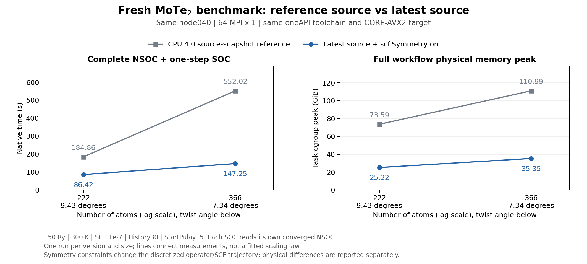

# Same-node reference vs latest CPU defaults — 2026-11-06

This is a new matched comparison of the repository's CPU4.0 source-snapshot reference and the latest unified CPU code using `scf.Symmetry on`. Earlier optimized snapshots are not substituted for the latest code.

## Configuration and measurement

Both versions ran sequentially on **node040, Xeon Gold6530, 64 physical cores, 64 MPI×1 thread**, with CPUs0–63 pinned and Intel MPI shared-memory transport. Both were compiled from source using oneAPI2022.3, MPI2021.7.1, MKL2022.2.1 and `CORE-AVX2`. The reference uses the bundled installed CPU4.0 snapshot and the stock build profile; it has not been independently authenticated as an untouched official release.

The MoTe₂ AA inputs use the qk basis and MLFF cell-relaxed structures: 9.43°, **222 atoms / 3848 scalar AOs**; 7.34°, **366 atoms / 6344 scalar AOs**. At each angle, complete structure/basis blocks and physical input values were checked identical between versions; the latest input additionally enables `scf.Symmetry on`. Both retain 150 Ry, 300 K, SCF criterion1e-7, History30, StartPulay15, native energy/force calculations and H/S output. Cube output is off for both. Each SOC starts from its own converged NSOC checkpoint at the same MPI layout.

Time is complete native `Elapsed.Time`; MPI launch intervals are recorded separately in the private run archive. Memory is whole-stage task cgroup `memory.peak`, including charged file cache and MPI processes, with shared pages counted once. Workflow peak is **max(NSOC peak, SOC peak)**, not the sum. These are one measurement per version/size; the two-point lines are not a scaling fit or a statistical uncertainty estimate.

## Results

| Atoms / angle | Configuration | NSOC (s) | One SOC (s) | Total (s) | NSOC peak (GiB) | SOC peak (GiB) | Core-hours |
|---|---|---:|---:|---:|---:|---:|---:|
| 222 / 9.43° | CPU4.0 snapshot | 109.717 | 75.144 | 184.861 | 47.920 | 73.595 | 3.286 |
| 222 / 9.43° | Latest automatic defaults | 48.204 | 38.219 | 86.423 | 23.619 | 25.224 | 1.536 |
| 366 / 7.34° | CPU4.0 snapshot | 385.039 | 166.984 | 552.023 | 66.972 | 110.987 | 9.814 |
| 366 / 7.34° | Latest automatic defaults | 84.954 | 62.294 | 147.248 | 32.830 | 35.348 | 2.618 |

Observed complete-flow speedups are **2.14× and 3.75×**. Workflow physical-memory peaks are lower by factors **2.92× and 3.14×**. NSOC iterations change 42→39 and46→44; these comparisons include both implementation optimizations and symmetry constraints, including their SCF trajectory differences.

Reference binary SHA256: `42b7a8558062c58bcc1d22c374eaa4f1e143415110d8ed0d88d18f50ef90f18c`.
Latest binary SHA256: `9f283700d330069d83a0e16c1f19d8bb20d3886274a95607f0734fa41c7a7c5e`.

## Default-profile integration and validation

The native switch now composes the complete verified optimization profiles, including eligible owner DM/EDM, compact work/history storage, shared grids, sparse transforms and D3-specific work reuse. Actual `-nt` and collective rank affinity control thread/binding-dependent caches. History is preserved; its symmetry compression is enabled only for supported History30 inputs. Other mixing/auxiliary settings select compatible options instead of activating unsupported caches.

Standard oriented C3/D3 slabs select the verified legacy SOC path, including its projected solve and native H/S export. D3-specific TR/real reuse is restricted to D3. Other supported geometries/subgroups use the general SOC implementation with compact storage. Explicit developer covariance requests retain their general-SOC checks; the raw covariance threshold was not relaxed to turn failed tests into successes.

203 regression tests pass. Small HgI₂ fixtures on gpuh204 completed full NSOC plus own one-step SOC for D2 at4MPI×1 and2MPI×2, C2, and C3. D2 single/mixed-thread H/S/DM/E/F comparisons pass. Separate one-step compatibility smoke tests for simple/default mixing and D3 History35 pass; these are not convergence or performance benchmarks.

For both MoTe₂ sizes, enabling the full memory profile preserves the earlier same-operator NSOC H/S, DM, energy, forces, electron count and Hermiticity within strict comparison gates. The 222-atom SOC also matches the historical same-operator legacy D3 output. Complete EDM and eigenvectors are not present in scfout; no corresponding full-array audit is inferred from that file.

Against the raw reference, NSOC energy differences are approximately0.06639 and0.06361meV/atom, while maximum force differences are approximately12.44 and12.48meV/Å. The latter exceed the earlier1meV/Å physical gate. Thus implementation equivalence is separate from raw-reference physical accuracy; the speedups do not establish identical raw H/S or universally acceptable force errors. Exact NSOC and SOC differences are in [physical_differences.json](physical_differences.json).

Before this default-profile fix, two same-session SOC runs failed the general raw-H/S covariance gate, and many memory flags were inactive. Those failed runs and intermediate builds remain in the private archive, separately from these successful final results; partial failure times/peaks are not used as speed or memory gains.

## Data and reproduction

- [measurements.csv](measurements.csv): individual matched measurements, hashes, iteration counts and core-hours.
- [provenance.json](provenance.json): hardware, compiler, input checks and measurement scope.
- [plot.py](plot.py): regenerate this PNG and [SVG](latest_vs_reference.svg) with `python plot.py` in a Python environment containing Matplotlib.

The complete private archive is indexed by `openmx_latest_vs_reference_20261106`, including exact inputs, commands, build manifests, stage-owned cgroups, logs, own checkpoints and numerical comparisons. No new small-angle production calculations were launched for this report.
