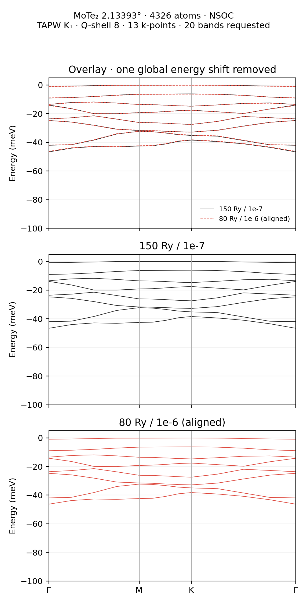
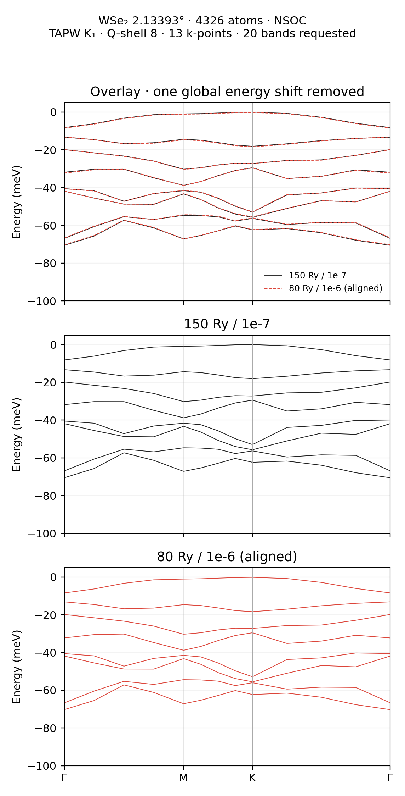

# Integration cutoff and valence bands / 积分 cutoff 与价带

Saved results; no new calculations were launched for this documentation.
本页整理已有结果，没有为发布补算新任务。

## Systems and settings / 体系与设置

| Material | Angle | Atoms | Scalar AO | Reference | Candidate |
|---|---:|---:|---:|---|---|
| MoTe2 | 2.13393° | 4326 | 74984 | 150 Ry, criterion 1e-7 | 80 Ry, criterion 1e-6 |
| WSe2 | 2.13393° | 4326 | 67774 | 150 Ry, criterion 1e-7 | 80 Ry, criterion 1e-6 |

Each pair has matching relaxed-cell geometry, atomic basis and pseudopotentials.
MoTe2 uses Mo7.0-s3p2d1 / Te7.0-s3p2d2 and Mo_PBE19 / Te_PBE19.
WSe2 uses W7.0-s3p2d2 / Se7.0-s3p2d1 and W_PBE19 / Se_PBE19.
The reference uses an older compact executable; the candidate uses v6-clean.
Thus cutoff, criterion and binary differ: **this is not a single-variable cutoff
convergence study**. No 300 Ry reference for these structures is provided here.

同一材料配对使用相同弛豫晶胞、基组及赝势；旧参考二进制不同，因此不能把全部差异
归因于 cutoff，也不能据此认定 150 Ry 已经收敛。

Band postprocessing used the `moirekp` environment on bigmem001 (MoTe2) and
bigmem002 (WSe2), TAPW K1, Q-shell 8, matching nonorthogonal H/S, NSOC.
Each old/new case used 13 independent k workers, 4 BLAS threads each, with
both configurations concurrently processed on the corresponding node.
Gamma-M-K-Gamma has 5 points per segment including endpoints, 13 plotted points
after shared endpoints. Twenty states were requested; the highest eight returned
valence states are compared. No additional H/S symmetrization was applied.
This is a sampled TAPW comparison, not a full-AO, full-zone or SOC validation.

## Alignment / 整体能量对齐

For each material, let x be the 13 k samples and 8 retained band indices:

```
delta = mean_x(E80(x) - E150(x))
difference_meV(x) = 1000 * (E80(x) - E150(x) - delta)
RMS = sqrt(mean_x(difference_meV(x)^2))
maximum = max_x(abs(difference_meV(x)))
```

Only one constant is removed across the entire set; no per-k or per-band fitting.
The figures share the reference valence maximum as their display zero.
每种材料只扣除一个全局常数，不逐条带或逐 k 点拟合。

| Material | Removed E80−E150 shift | Aligned RMS | Aligned maximum |
|---|---:|---:|---:|
| MoTe2 | 27.476206 meV | 0.148710 meV | 0.359147 meV |
| WSe2 | 12.827603 meV | 0.179587 meV | 0.436594 meV |




Black solid: 150 Ry / 1e-7. Red dashed: aligned 80 Ry / 1e-6.
Each figure has overlay, reference and candidate rows.

## Total energy and forces / 总能量与力

| Material | Absolute energy difference per atom | Maximum atomic force-vector difference |
|---|---:|---:|
| MoTe2 | 98.023584 meV/atom | 312.207168 meV/angstrom |
| WSe2 | 21.112742 meV/atom | 239.338785 meV/angstrom |
| Previously requested acceptance | <=0.1 meV/atom | <=1 meV/angstrom |

Both pairs fail these energy/force thresholds. Band-shape agreement after a
constant shift does not justify structural relaxation or total-energy claims.
This report does not change any cutoff or convergence defaults. The historical
runs differ in layout/binary, and MoTe2 had concurrent-worker interference;
no clean cutoff-only speedup is claimed.

两种材料的能量与力差均未通过原门限；价带形状接近不等于结构优化精度通过。
这里不修改默认精度，也不宣称只降低 cutoff 带来的严格加速比。

## Data / 数据

- [MoTe2 values](MoTe2.csv), [WSe2 values](WSe2.csv): raw old/new energies in eV,
  fractional k coordinates, aligned differences in meV.
- [Summary](summary.csv), [MoTe2 provenance](MoTe2.json),
  [WSe2 provenance](WSe2.json): settings, source counts, binary identifier,
  data hashes and scope. Machine-specific paths and full H/S files are omitted.
