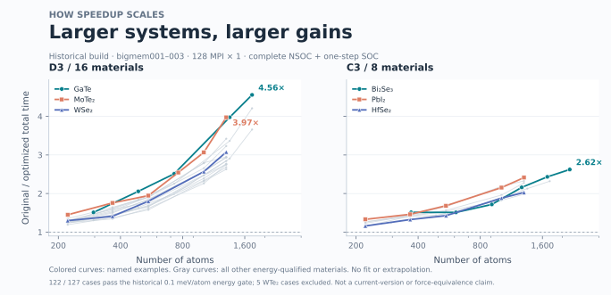

# Historical bigmem size scaling — 22–23 October 2026

This is the **earlier specialized NSOC/SOC optimization**, not a benchmark of the current unified release. It supplements the separately reported current regular256 measurements. Do not combine their times or memory figures into a single code-version comparison.

The saved table covers **25 materials / 127 structures**. All 127 have successful matched run metadata after resolving the original report's retry overrides. **122 structures in 24 materials** pass the historical energy threshold (0.1 meV/atom for NSOC and one-step SOC); five WTe₂ structures fail and are omitted from the plotted curves, while retained in the data.



## Method and scope

- bigmem001–003, 128 MPI × 1; original and optimized members of each pair run on the same node. Different sizes may use different bigmem nodes, so this is not a single fixed-host scaling sweep.
- Frozen original-4.0 reference, specialized NSOC D3 equivalent-block reuse / C3 conjugate-pair path, and separately frozen C3/D3 spinor SOC executable. Exact binary and input hashes for each run are in `measurements.json`.
- Fixed geometry and published basis/pseudopotential settings, 150 Ry, 300 K, Gamma / Cluster, criterion 1e-7 and StartPulay15. Full NSOC followed by one SOC step from **each branch's own** converged NSOC checkpoint, with native energy, force and H/S output retained. One SOC step is not self-consistent SOC.
- Total timing follows the saved report: measured NSOC native-launch wall plus measured SOC native-launch wall. External symmetry preparation, restart-directory copying and hashing are outside this historical timing. The current regular256 report includes preparation, so these timings are not interchangeable.
- Speedup = original total / optimized total; same 128-core layout makes this also the paired core-hour reduction factor. Each point is a single matched pair, without repeat statistics.
- All energy-qualified curves are drawn. Named examples are emphasized; gray curves show the others. X is logarithmic atom count; Y is a linear speedup ratio. Lines connect measurements and are not regression fits. Growth with size is an observed overall trend, not strict monotonic behavior for every material.
- Energy qualification does not establish force equivalence, band agreement, or suitability for geometry relaxation. Earlier MoTe₂ force comparisons exceeded 1 meV/Å. The figure does not claim identical discretized operators.
- Historical rank peak RSS sums are not synchronized physical-memory peaks. This dataset must **not** be used to claim a particular memory reduction versus current cgroup measurements.

## Examples at the smallest common angle, 3.89°

| Material | Atoms | Group | Original total (s) | Historical optimized total (s) | Speedup |
|---|---:|---|---:|---:|---:|
| GaTe | 1736 | D3 | 4692.06 | 1029.97 | 4.56× |
| InSe | 1736 | D3 | 3296.89 | 783.47 | 4.21× |
| MoTe2 | 1302 | D3 | 3278.62 | 824.97 | 3.97× |
| WSe2 | 1302 | D3 | 2369.90 | 770.42 | 3.08× |
| HfS2 | 1302 | D3 | 2173.71 | 789.71 | 2.75× |
| Bi2Se3 | 2170 | C3 | 9775.05 | 3727.16 | 2.62× |

Across this historical dataset the largest energy-qualified total speedup is GaTe 3.89°, 1,736 atoms, **4.56×** (NSOC 3.94×, one-step SOC 5.78×). These are measured historical results, not predictions or current-release speedup claims. The minimum paired angle is 3.89°; smaller optimized-only runs are outside this benchmark.

## Data and reproduction

`measurements.json` retains all 127 rows, pass/fail status, atom/AO counts, stage times and run/binary/input hashes. `verification.json` records source-table/plan hashes and the metadata checks. No private filesystem paths or experimental inputs are published.

```bash
python plot.py
```

NumPy and Matplotlib regenerate the PNG/SVG/PDF from the saved data; no new simulations run. The current unified code inherits related symmetry ideas and adds memory and solver changes, but matching source ancestry is not evidence of identical performance. A present-version speedup claim requires its own matched measurements.
