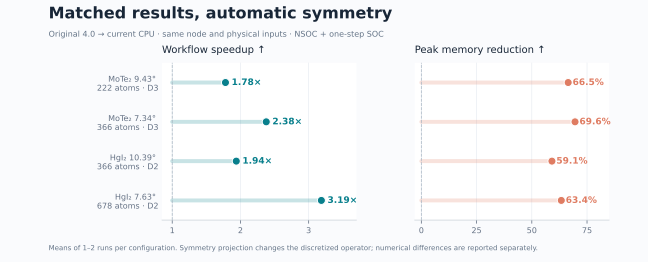
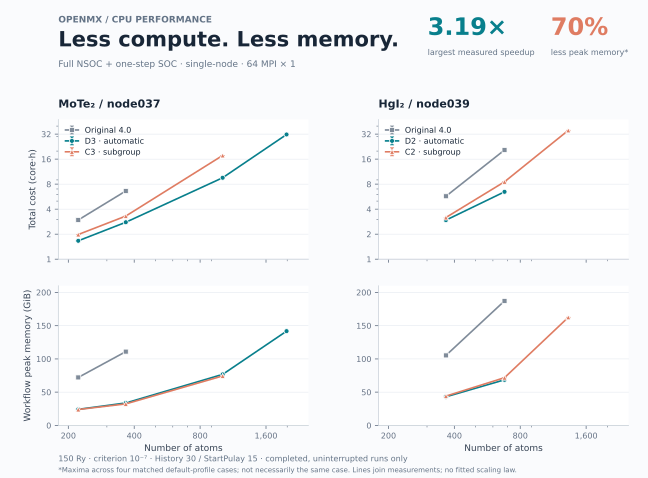

# regular256 matched CPU benchmark — 10 November 2026

This is an interim measurement snapshot, not a completed all-material benchmark.

## What is measured

- Source commit: `2c63864f1231fe3e5cd0f865071c439a6cbb6d35`. Stock and unified are separately built binaries from the same frozen source tree; the stock build uses the original CPU source profile.
- Two materials: published AA relaxed-cell qk MoTe₂ and published AA fixed-cell qk HgI₂. Four symmetry paths: D3/C3 and D2/C2. `scalar_AO` is the spinless basis order; SOC spinor order is twice that.
- Hardware: Intel Xeon Gold 6530, 2 sockets x 32 physical cores, approximately 251 GiB/node. MoTe₂ is measured on node037, HgI₂ on node039. Each matched pair uses the same node and physical-input contract hash.
- Layout: 64 physical cores, 64 MPI × 1; Intel MPI shared-memory transport. oneAPI2022.3 / Intel MPI2021.7.1 / MKL2022.2.1; shm transport; moirekp Python3.11.15.
- Input: Gamma / Cluster, 300 K, 150 Ry, criterion 1e-7, History30, StartPulay15. Basis sets, pseudopotentials and atomic geometry are fixed within every pair. Symmetry projection itself changes the discretized operators and SCF trajectory.
- Workflow: converge NSOC from a fresh start, then evaluate one SOC step from **that run's own C2N checkpoint**. Both stages normally finish and export H/S. This is not converged SOC or a band-solver timing.
- Time: sum of launch_wall_seconds for NSOC/SOC; includes symmetry preparation and native force evaluation; excludes queue, compilation, bands and H/S comparison.
- Memory: max of dedicated NSOC/SOC cgroup memory.peak, includes shared pages once and file cache; not sum RSS; not whole-node MemUsed. Workflow peak is max(NSOC peak, SOC peak), since stages run sequentially. It is not their sum.
- Core-hours = total seconds × 64 / 3600. Speedup = mean original total / mean current total. Memory reduction = 1 − mean current workflow peak / mean original workflow peak.
- Means of 1–2 sequential runs/configuration; ranges in the scaling plot are observed min/max, not confidence intervals. No claim of statistically precise noise-free speedup.

## Automatic-profile comparisons



| Material / atoms | Group | Original → current (s) | Speedup | Peak original → current (GiB) | Memory saved |
|---|---|---:|---:|---:|---:|
| MoTe₂ 9.43° / 222 | D3 | 166.8 → 93.7 | **1.78×** | 72.1 → 24.2 | 66.5% |
| MoTe₂ 7.34° / 366 | D3 | 372.4 → 156.6 | **2.38×** | 110.9 → 33.8 | 69.6% |
| HgI₂ 10.39° / 366 | D2 | 321.9 → 166.0 | **1.94×** | 105.3 → 43.0 | 59.1% |
| HgI₂ 7.63° / 678 | D2 | 1160.2 → 364.1 | **3.19×** | 187.2 → 68.6 | 63.4% |

| Material / atoms | Repeats original/current | NSOC steps original/current | Max energy difference (meV/atom) | NSOC max force difference (meV/Å) | SOC max force difference (meV/Å) |
|---|---:|---:|---:|---:|---:|
| MoTe2 / 222 | 1/1 | 42/39 | 0.0663898 | 12.4446 | 12.3662 |
| MoTe2 / 366 | 2/1 | 46/44 | 0.0636143 | 12.4825 | 12.4038 |
| HgI2 / 366 | 1/1 | 38/38 | 7.8138e-05 | 0.142238 | 0.0981452 |
| HgI2 / 678 | 2/2 | 39/39 | 0.000128125 | 0.237473 | 0.149879 |

Energy difference is the larger absolute per-atom difference over the two stages. Force difference is the maximum norm of the per-atom force vector difference, with atoms in matching order. These values are recalculated from native output files; force calculation was not disabled. All four pairs pass 0.1 meV/atom; the MoTe₂ pairs fail 1 meV/Å. The timing table must not be presented as strict implementation equivalence or validation for geometry relaxation. Full H/S differences are separate from these energy/force measurements; there is no new band-shape claim here.

## Size and subgroup measurements



Automatic profiles are the solid teal curves; explicit C3/C2 subgroup runs are coral. Original 4.0 is gray. Atom count and cost use logarithmic axes; memory uses a linear vertical axis. Lines connect measurements only. Larger systems without completed baseline workflows have no claimed speedup.

`summary.json`/`summary.csv` also retain the separately labeled optional low-memory D3 measurements. They are **not** mixed into the automatic-profile curves or headline speedups. In particular, a lower-memory optional profile can be slower than the default. The earliest 222-atom low-memory record used an earlier SOC memory configuration and is retained as historical data, not the headline comparison.

## Exclusions and incomplete work

`excluded.json` identifies incomplete, memory-limited and externally frozen cases at this snapshot. No failed, paused or interrupted elapsed time enters the displayed speedup. Latest-symmetry-off runs and other cutoffs are outside this report. New-node expansion runs are outside this same-node table. Missing original large-system records do not imply that they fit a 251 GiB node. The initial 1,014-atom MoTe₂ stock SOC attempt stopped under the older memory guard; it is not an OOM result or a successful timing.

## Reproduce the plots

```bash
python plot.py
```

Requires Python, NumPy and Matplotlib. The script reads only the included JSON summaries and regenerates PNG, SVG and PDF; no OpenMX calculations are launched. `measurements.json` retains per-stage time, energy, memory, source-record hashes and physical-input hashes without private filesystem paths. `paired.csv` supplies the four headline comparisons. `provenance.json` pins the source, binaries, hardware, environment and plotting references.

Presentation draws on the compact result-first organization of [vLLM's performance report](https://vllm.ai/blog/2024-09-05-perf-update) and [cuML's per-case speedup reporting](https://docs.nvidia.com/cuml/latest/cuml-accel/benchmarks/). All plotted measurements are this project's own; no external performance values are mixed in.
